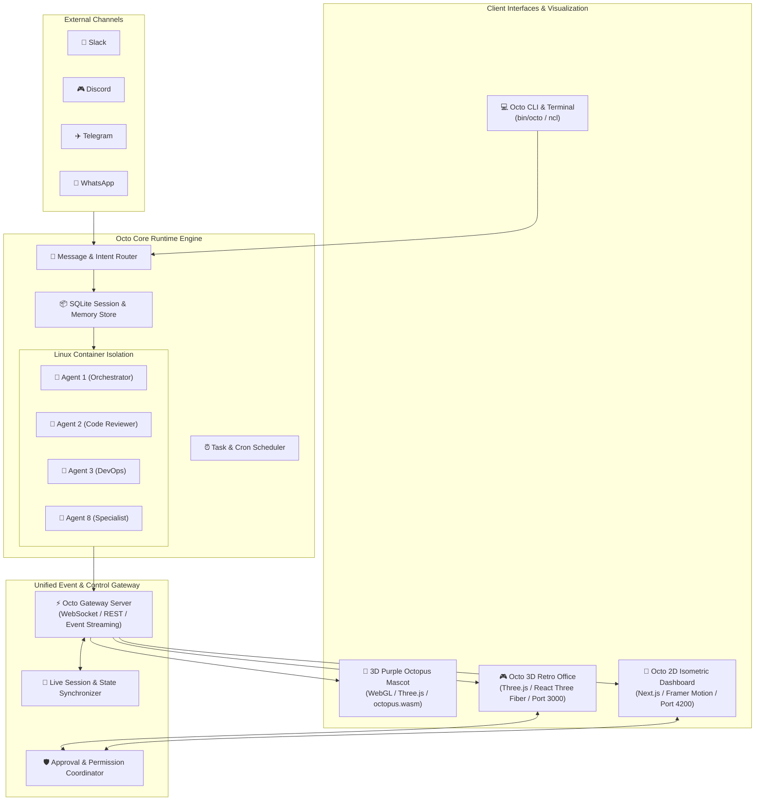
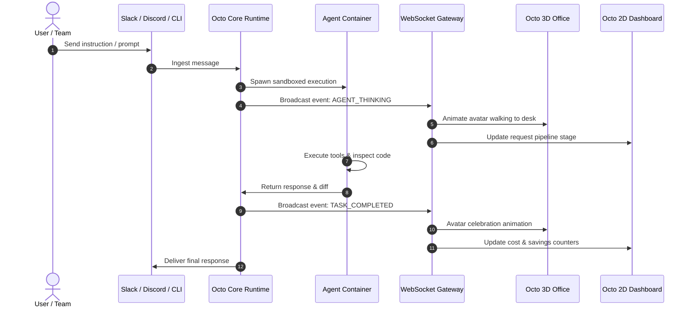

# 🏗️ Octo Agent — Architecture & System Design

**Octo Agent** unites three agent ecosystems into a unified platform:
1. **Containerized Autonomous Runtime** (derived from NanoClaw)
2. **3D Virtual Office & Studio Workspace** (derived from Claw3D)
3. **2D Isometric Workflow Pipeline Dashboard** (derived from OpenClaw Office)
4. **Interactive 3D Purple Octopus Mascot & Avatar** (custom WebGL GLTF shader engine)

---

## 📐 System Architecture Diagram

---

## 🧩 Architectural Pillars

### 1. Octo Core (`packages/octo-core`)
- **Container Isolation**: Unlike monolithic agent frameworks running everything in a single Node/Python process, each Octo Agent runs inside its own isolated Linux container with strictly mounted filesystems.
- **State Management**: Built on high-performance SQLite (`better-sqlite3`), tracking conversation history, task schedules, credentials, and token usage.
- **Multi-Channel Adapters**: Native support for Slack, Discord, Telegram, WhatsApp (Baileys), Webhooks, and CLI.

### 2. Octo 3D (`packages/octo-3d`)
- **Walkable Retro Office**: Live retro-styled 3D office rendered with Three.js and React Three Fiber.
- **Office Builder (`/office/builder`)**: Interactive grid editor to design custom office layouts, place desks, water coolers, meeting rooms, and servers.
- **Live Agent Presence**: Agents move between desks, meeting tables, and the PR review room based on real-time task states.
- **Chief Octo Mascot (`/mascot`)**: Live WebGL 3D purple octopus model serving as the orchestrator avatar with procedural tentacle kinematics and eye gaze tracking.

### 3. Octo Office (`packages/octo-office`)
- **Isometric Office Dashboard**: Real-time 2D isometric overview with live desk status and agent sprite animations.
- **Multi-Step Request Pipeline**: Visualizes task delegation chains (User $\to$ Chief Octo $\to$ Specialist Agent $\to$ Validation).
- **Cost & Productivity Tracker**: Real-time telemetry monitoring token usage, API savings, and task turnaround time.

### 4. 3D Mascot Engine (`public/mascot/` & `packages/octo-3d/public/mascot/`)
- **Binary Model**: `octopus.wasm` (a binary GLTF/GLB 3D asset, 7.5 MB).
- **Vertex Shader Deformations**: Procedural harmonic waving across all 8 tentacles using golden-angle phase offsets ($\Delta \theta = 2.399 \text{ rad}$).
- **Eye & Pupil Tracking**: Jacobian inverse matrix projection mapping mouse screen coordinates into 2D UV texture space for lifelike eye following and natural blinking cycles.

---

## 🔄 Gateway Communication Lifecycle

---

## 🔒 Security & Sandboxing Principles

1. **OS-Level Isolation**: Agents cannot access the host machine's filesystem or environment variables outside explicit mounts.
2. **Permission Gateways**: Risky bash or write operations trigger an approval modal in the 3D Studio and CLI.
3. **Zero Secret Leaks**: Credentials are held securely in the gateway and never passed as raw environment variables to container shells.
