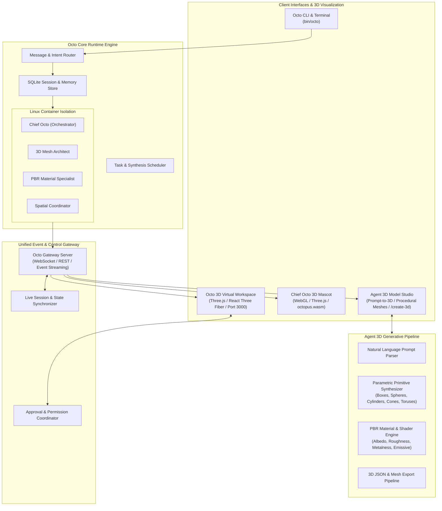
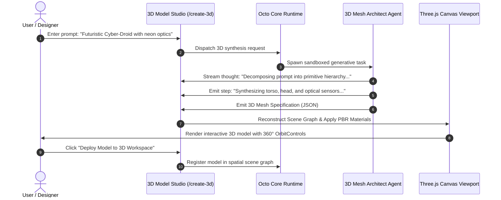

# Octo Agent — Architecture & System Design

**Octo Agent** provides a unified platform connecting autonomous AI agents to 3D model creation, procedural mesh synthesis, and spatial 3D virtual environments:
1. **Agent 3D Model Creation Studio (`/create-3d`)** — Natural language prompt-to-3D agent synthesis engine and interactive Three.js viewport
2. **Octo 3D Virtual Workspace (`/office`)** — Spatial 3D environment and interactive workspace
3. **Chief Octo 3D Mascot Model (`/mascot`)** — Interactive WebGL GLTF shader engine and chief orchestrator avatar (`octopus.wasm`)
4. **Octo Core Engine (`packages/octo-core`)** — Containerized autonomous runtime with filesystem isolation for safe tool execution

---

## System Architecture Diagram

---

## Architectural Pillars

### 1. Agent 3D Model Creation Studio (`packages/octo-3d/src/app/create-3d`)
- **Natural Language Prompt-to-3D**: Autonomous agents transform text prompts into structured 3D component trees.
- **Parametric Mesh Synthesis**: Supports multi-geometry combinations including cubes, spheres, cylinders, cones, and toruses.
- **PBR Material Customizer**: Live adjustments for color, roughness, metalness, wireframe mode, and emissive neon shaders.
- **Interactive WebGL Viewport**: Full 360° orbit, zoom, pan, floating animation toggles, and coordinate grid visualization.
- **Export & Workspace Deployment**: Instant 3D JSON specification export and one-click deployment directly into the 3D virtual office.

### 2. Octo 3D Spatial Workspace (`packages/octo-3d`)
- **Walkable Retro Office**: Live 3D environment rendered with Three.js and React Three Fiber.
- **Interactive Layout Builder (`/office/builder`)**: Spatial grid editor to customize environments and place custom 3D models.
- **Spatial Agent Terminals**: Inspect agent activity, synthesis logs, and tool executions in situ.

### 3. Chief Octo 3D Mascot (`public/mascot/` & `/mascot`)
- **Binary Model Asset**: `octopus.wasm` (a binary GLTF/GLB 3D asset, 7.18 MB).
- **Vertex Shader Deformations**: Procedural harmonic waving across all 8 tentacles using golden-angle phase offsets ($\Delta \theta = 2.399 \text{ rad}$).
- **Eye & Pupil Tracking**: Jacobian inverse matrix projection mapping mouse screen coordinates into 2D UV texture space for lifelike eye tracking and natural blinking.

### 4. Octo Core Engine (`packages/octo-core`)
- **Container Isolation**: Each Octo Agent executes inside its own isolated Linux container with strictly mounted filesystems.
- **State Management**: Built on high-performance SQLite (`better-sqlite3`), tracking conversation history, task schedules, credentials, and token usage.
- **Multi-Channel & CLI**: Seamless integration with the `octo` CLI, webhooks, and REST endpoints.

---

## Agent-to-3D Synthesis Lifecycle

---

## Security & Sandboxing Principles

1. **OS-Level Isolation**: Agents cannot access the host machine's filesystem or environment variables outside explicit mounts.
2. **Permission Gateways**: Risky bash or write operations trigger an approval modal in the Studio UI and CLI.
3. **Zero Secret Leaks**: Credentials are held securely in the gateway and never passed as raw environment variables to container shells.
