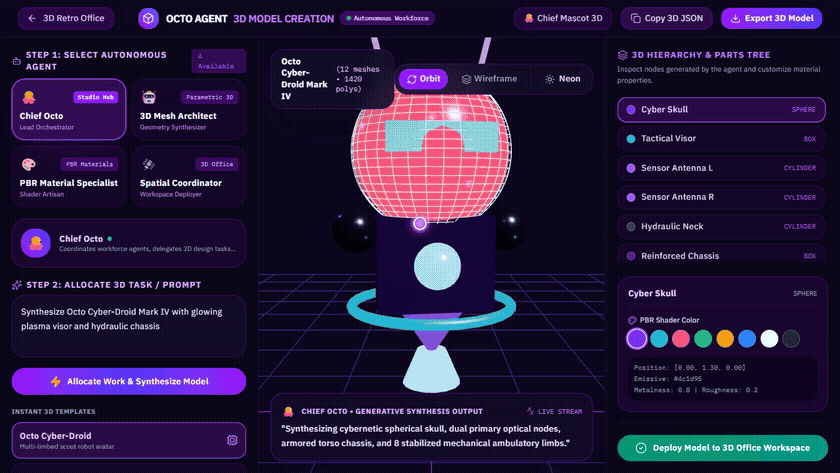

<p align="center">
  
</p>

<p align="center">
  <strong>Autonomous AI Agents Connected to 3D Model Creation &amp; Spatial 3D Workspace</strong>
</p>

<p align="center">
  <a href="https://github.com/Aravindh-dev12/octo-agent-workforce"></a>
  <a href="#quick-start"></a>
  <a href="#architecture-pillars"></a>
  <a href="public/mascot/index.html"></a>
  <a href="LICENSE"></a>
</p>

---

## Overview

**Octo Agent** bridges autonomous AI reasoning agents directly with **interactive 3D model creation**, parametric mesh synthesis, and spatial 3D virtual environments. Rather than interacting with agents through flat text consoles, Octo Agent empowers your agents to translate natural language prompts into fully rendered, downloadable, and deployable 3D assets in real time.

Repository: **[https://github.com/Aravindh-dev12/octo-agent-workforce](https://github.com/Aravindh-dev12/octo-agent-workforce)**

---

## 🎬 Live 3D Model Creation Demo

<p align="center">
  
</p>

<p align="center">
  <em><strong>Full Workflow Walkthrough:</strong> Select Autonomous Agent ➔ Allocate 3D Task Prompt ➔ Real-Time WebGL Parametric Synthesis ➔ 360° Orbit &amp; Camera Inspection ➔ PBR Material &amp; Shader Customization ➔ Deployment to 3D Office Workspace</em>
</p>

> [!TIP]
> 📺 A high-definition MP4 recording is also included in the repository: [`assets/demo-3d-model-creation.mp4`](assets/demo-3d-model-creation.mp4).

---

## Core Pillars

<table>
  <thead>
    <tr>
      <th align="center">Icon</th>
      <th align="left">Pillar</th>
      <th align="left">Location</th>
      <th align="left">Description</th>
    </tr>
  </thead>
  <tbody>
    <tr>
      <td align="center"></td>
      <td><strong>Agent 3D Model Studio</strong></td>
      <td><code>/create-3d</code></td>
      <td>Natural language prompt-to-3D agent synthesis, parametric geometry construction, live PBR shader customization, and 3D JSON/GLTF export.</td>
    </tr>
    <tr>
      <td align="center"></td>
      <td><strong>Octo 3D Virtual Workspace</strong></td>
      <td><code>/office</code></td>
      <td>Walkable 3D environment, spatial agent terminals, custom floorplan builder, and real-time agent presence rendered via Three.js.</td>
    </tr>
    <tr>
      <td align="center"></td>
      <td><strong>Chief Octo 3D Model</strong></td>
      <td><code>/mascot</code></td>
      <td>Interactive WebGL 3D GLTF asset (<code>octopus.wasm</code>) with real-time cursor gaze tracking, tentacle wave kinematics, and live speech bubbles.</td>
    </tr>
    <tr>
      <td align="center"></td>
      <td><strong>Octo Core Runtime</strong></td>
      <td><code>packages/octo-core</code></td>
      <td>Secure agent runtime with Linux container filesystem isolation, SQLite state management, and multi-channel messaging via the <code>octo</code> CLI.</td>
    </tr>
  </tbody>
</table>

---

## Agent 3D Model Creation Studio (`/create-3d`)

The **Agent 3D Studio** gives autonomous agents the ability to dynamically generate complex 3D objects from natural language prompts through an orchestrated 5-stage synthesis pipeline:

### Autonomous 3D Creation Workflow

1. **Step 1: Select Autonomous Agent**: Choose specialist synthesis agents from the workforce panel:
   - 🐙 **Chief Octo** (`Lead Orchestrator`): Coordinates tasks and delegates prompts across synthesis specialists.
   - 🤖 **3D Mesh Architect** (`Geometry Synthesizer`): Deconstructs prompts into parametric geometry nodes (boxes, spheres, cylinders, gyros).
   - 🎨 **PBR Material Specialist** (`Shader Artisan`): Configures roughness, metalness, and emissive neon shaders.
   - 🛰️ **Spatial Coordinator** (`Workspace Deployer`): Validates collision bounds and deploys models into the 3D office.
2. **Step 2: Allocate 3D Task / Prompt**: Assign tailored design instructions (e.g. *"Build high-density Quantum Neural Terminal with liquid neon cooling ducts"* or *"Synthesize Octo Cyber-Droid Mark IV"*).
3. **Step 3: Real-Time Generative Synthesis**: Watch the agent execute parametric decomposition in the live construction log with instant polygon estimation.
4. **Step 4: Interactive WebGL Inspection**:
   - Smooth **360° Camera Orbit** and pan controls.
   - **Parts Hierarchy Tree**: Click any node (e.g. *Tactical Visor*, *Holo Terminal Screen*, *Coolant Tube*) to isolate parts with an active wireframe highlight.
   - **Live PBR Color Tweaker**: Modify material diffuse colors and emissive neon channels in real time.
   - **Dynamic Lighting Schemes**: Switch between *Neon Cyberpunk*, *Clean Studio*, and *Matrix Emerald* illumination modes.
5. **Step 5: Workspace Deployment**: Deploy the finalized 3D asset directly to active desk workstations inside the **Octo 3D Virtual Workspace** (`/office`) or export the 3D JSON specification.

---

## 3D Mascot Model Engine (`octopus.wasm`)

The Chief Octo mascot is an interactive binary 3D asset (`public/mascot/octopus.wasm`, 7.18 MB) rendered in native WebGL:

- **Procedural Tentacle Kinematics**: Harmonic wave equations deform all 8 arms dynamically with golden-angle phase offsets ($\Delta \theta = 2.399 \text{ rad}$).
- **Real-Time Gaze Tracking**: Inverted Jacobian screen-to-UV matrix maps mouse coordinates directly to eye texture UV space, allowing the octopus to follow user interaction.
- **Autonomous Blinking & Speech**: Procedural eyelid gestures and dynamic speech bubbles synced to agent actions.
- **Standalone Viewer**: Launch via `npm run mascot` to access the zero-dependency WebGL viewer at `http://localhost:8080`.

---

## Monorepo Layout

```
octo-agent-workforce/
├── packages/
│   ├── octo-3d/          Octo 3D workspace, layout builder & Agent 3D Model Studio
│   └── octo-core/        Octo Core containerized agent engine & CLI (`octo`)
├── public/
│   ├── mascot/           3D animated octopus model (octopus.wasm & index.html)
│   └── logo.svg          Flat vector SVG brand logo
├── assets/
│   ├── octo-logo.svg     Flat vector branding banner
│   └── icons/            Flaticon-style SVG vector icons
├── scripts/
│   ├── serve-mascot.js   Native HTTP server for the 3D mascot model
│   ├── start-all.ps1     PowerShell startup script
│   └── start-all.sh      Bash startup script
├── AGENTS.md             Workforce roles, personas, and 3D synthesis procedures
├── ARCHITECTURE.md       System specifications, sequence flows, and protocols
└── package.json          Root monorepo workspace configuration
```

---

## Quick Start

### 1. Requirements
- Node.js 20+ or 22+
- npm 10+
- Docker (optional, recommended for OS-level container isolation)

### 2. Clone & Install

```bash
git clone https://github.com/Aravindh-dev12/octo-agent-workforce.git
cd octo-agent-workforce
npm install
```

### 3. Launch Services

Run the full 3D platform:

```bash
# Start Agent 3D Model Studio & 3D Workspace (Port: 3000)
npm run dev:3d
```

Open your browser to:
- **Agent 3D Model Creation Studio**: [http://localhost:3000/create-3d](http://localhost:3000/create-3d)
- **Octo 3D Virtual Workspace**: [http://localhost:3000/office](http://localhost:3000/office)
- **3D Mascot Viewer**: [http://localhost:3000/mascot](http://localhost:3000/mascot)

To run the standalone 3D Mascot HTTP server:
```bash
npm run mascot
# URL: http://localhost:8080
```

To run the Octo Core containerized runtime:
```bash
npm run dev:core
```

One-click startup on Windows:
```powershell
.\scripts\start-all.ps1
```

One-click startup on Linux / macOS:
```bash
bash scripts/start-all.sh
```

---

## CLI Reference

Octo Agent includes a terminal CLI (`octo`) to manage agent containers and synthesis tasks:

```bash
# View command help
npm run octo -- --help

# Start interactive agent session
npm run octo -- chat

# Run diagnostic health check
npm run octo -- doctor

# Inspect active agent sessions
npm run octo -- sessions
```

---

## Navigation & Shortcuts

| Route | View | Description |
|---|---|---|
| `/create-3d` | **Agent 3D Studio** | Prompt-to-3D generator, mesh inspector, PBR material editor. |
| `/office` | **3D Workspace** | Walkable 3D virtual environment with interactive agent desks. |
| `/office/builder` | **Layout Builder** | Interactive 3D grid editor to customize office floors and assets. |
| `/mascot` | **Chief Octo Mascot** | Full-screen 3D interactive octopus with gaze kinematics. |

---

## Security Model

- **Filesystem Isolation**: Agents run inside sandboxed Linux containers and only access explicit mounts.
- **Controlled Egress**: Network egress policies prevent unauthorized external connections from agent shells.
- **Approval Gates**: High-impact file writes and bash executions require operator confirmation via the Studio UI or CLI.

---

## License

This project is licensed under the [MIT License](LICENSE).
