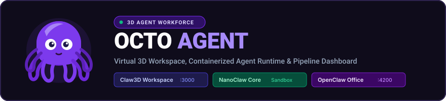

<p align="center">
  
</p>

<p align="center">
  <strong>3D Autonomous Multi-Agent Workforce &amp; Virtual Office Platform</strong>
</p>

<p align="center">
  <a href="#quick-start"></a>
  <a href="#architecture-pillars"></a>
  <a href="public/mascot/index.html"></a>
  <a href="LICENSE"></a>
</p>

---

## Overview

**Octo Agent** provides a persistent 3D spatial workspace, containerized execution runtime, and live telemetry dashboard for autonomous AI agents. Rather than interacting with agents solely through terminal output and log files, Octo Agent establishes spatial presence, room-based routing, and real-time collaboration inside an interactive 3D office.

The platform coordinates your AI workforce across three native pillars:

<table>
  <thead>
    <tr>
      <th align="center">Icon</th>
      <th align="left">Pillar</th>
      <th align="left">Package</th>
      <th align="left">Description</th>
    </tr>
  </thead>
  <tbody>
    <tr>
      <td align="center"></td>
      <td><strong>Octo 3D Workspace</strong></td>
      <td><code>packages/octo-3d</code></td>
      <td>Walkable retro 3D office, desk assignments, layout editor, and PR review center rendered via Three.js and React Three Fiber.</td>
    </tr>
    <tr>
      <td align="center"></td>
      <td><strong>Octo Core Engine</strong></td>
      <td><code>packages/octo-core</code></td>
      <td>Secure agent runtime with OS-level Linux container filesystem isolation, SQLite state management, and multi-channel messaging.</td>
    </tr>
    <tr>
      <td align="center"></td>
      <td><strong>Octo Office Dashboard</strong></td>
      <td><code>packages/octo-office</code></td>
      <td>2D isometric dashboard with multi-step pipeline visualization, token spend metrics, and live task delegation graphs.</td>
    </tr>
    <tr>
      <td align="center"></td>
      <td><strong>Chief Octo 3D Model</strong></td>
      <td><code>public/mascot</code></td>
      <td>Interactive WebGL 3D model (<code>octopus.wasm</code>) featuring real-time mouse gaze tracking, wave kinematics, and live speech bubbles.</td>
    </tr>
  </tbody>
</table>

---

## 3D Mascot Model Engine

The chief orchestrator avatar is powered by the binary GLTF/GLB model (`public/mascot/octopus.wasm`):

- **Arm Kinematics**: Custom vertex shaders dynamically deform each of the 8 arms using harmonic phase offsets ($\Delta \theta = 2.399 \text{ rad}$).
- **Gaze Tracking**: Screen-to-UV Jacobian matrix inversion maps mouse coordinates directly to texture UV coordinates so the eyes track cursor movement.
- **Blinking**: Eyelid geometry deformation and pupil dilation cycles.
- **Embedded WebGL Viewer**: Launch via `npm run mascot` to access the standalone viewer on `http://localhost:8080`, or navigate to `/mascot` within the 3D office suite.

---

## Monorepo Layout

```
octo-agent-workforce/
├── packages/
│   ├── octo-3d/          Octo 3D retro virtual office, studio & layout builder
│   ├── octo-core/        Octo Core containerized agent engine & CLI (`octo`)
│   └── octo-office/      Octo Office 2D isometric dashboard & pipeline visualizer
├── public/
│   ├── mascot/           3D animated octopus model (octopus.wasm & index.html)
│   └── logo.svg          Flat vector SVG brand logo
├── assets/
│   ├── octo-logo.svg     Flat vector branding banner
│   └── icons/            Flaticon-style SVG vector icons
├── scripts/
│   ├── serve-mascot.js   Native HTTP server for the 3D mascot model
│   ├── start-all.ps1     PowerShell startup script
│   └── start-all.sh      Bash startup script
├── AGENTS.md             Workforce roles, personas, and operating procedures
├── ARCHITECTURE.md       System specifications, sequence flows, and protocols
└── package.json          Root monorepo workspace configuration
```

---

## Quick Start

### 1. Requirements
- Node.js 20+ or 22+
- Docker (optional, recommended for OS-level container isolation)
- Git

### 2. Setup

```bash
git clone https://github.com/Aravindh-dev12/octo-agent-workforce.git
cd octo-agent-workforce
npm install
```

### 3. Launching Applications

Run all services together or individually:

```bash
# Launch the Octo 3D Virtual Office (Default Port: 3000)
npm run dev:3d
# URL: http://localhost:3000/office

# Launch the Octo 3D Mascot Viewer (Port: 8080)
npm run mascot
# URL: http://localhost:8080

# Launch the Octo 2D Office Dashboard (Default Port: 4200)
npm run dev:office
# URL: http://localhost:4200

# Launch the Octo Core Agent Container Engine
npm run dev:core
```

On Windows PowerShell:
```powershell
.\scripts\start-all.ps1
```

On Linux or macOS:
```bash
bash scripts/start-all.sh
```

---

## CLI Reference

Octo Agent includes a command-line interface to interact with running agent containers:

```bash
# View command help
npm run octo -- --help

# Start interactive chat with active agents
npm run octo -- chat

# Run diagnostic checks on runtimes and gateway connectivity
npm run octo -- doctor

# List running container sessions
npm run octo -- sessions
```

---

## Octo 3D Workspace Controls

When running `npm run dev:3d` (`http://localhost:3000/office`):

- **Movement**: `WASD` or Arrow keys to walk across office zones.
- **Camera Orbit**: Left-click and drag to rotate the perspective; mouse wheel to zoom.
- **Desks & Terminals**: Approach any desk to view active tasks, agent outputs, and tool calls.
- **Layout Builder**: Open `/office/builder` to place desks, meeting tables, server bays, and decorative props.
- **Chief Mascot Chamber**: Navigate to `/mascot` for real-time orchestrator visualization and speech streams.

---

## Octo Office Dashboard Features

When running `npm run dev:office` (`http://localhost:4200`):

- **Pipeline Flow**: Real-time visualization of multi-agent task chains (e.g., Request $\to$ Chief Octo $\to$ Specialist $\to$ Verification).
- **Activity Streams**: Searchable and filterable logs with token usage and cost metrics.
- **Cost Telemetry**: Cumulative tracking of estimated savings and workflow durations.
- **Mascot View**: Switch to the Mascot tab to view the WebGL 3D model directly in the dashboard.

---

## Security Model

- **Filesystem Isolation**: Agents run inside sandboxed Linux containers and only access explicit mounts.
- **Controlled Egress**: Network egress policies prevent unauthorized external connections from agent shells.
- **Approval Gates**: High-impact file writes and bash executions require operator confirmation via the Studio UI or CLI.

---

## License

This project is licensed under the [MIT License](LICENSE).
